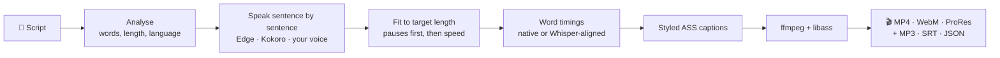

<h1 align="center">🎬 NarraReel</h1>

<h3 align="center">Your script. Your voice. Captions people watch to the end.</h3>

<p align="center">
  Turn a script you wrote into a finished Reel, Short or YouTube video, narrated in a free AI voice or <b>your own
  cloned voice</b>, cut to <b>the exact second</b>, with <b>word-by-word animated captions</b>.<br>
  Runs on your computer. No account. No API key. No watermark.
</p>

<p align="center">
  <a href="https://github.com/SanTiwari07/NarraReel/stargazers"></a>
  <a href="https://github.com/SanTiwari07/NarraReel/actions/workflows/ci.yml"></a>
  
  
  <a href="CONTRIBUTING.md"></a>
  <a href="notebooks/NarraReel_Colab.ipynb"></a>
</p>

<p align="center">
  <a href="#-quick-start">Quick start</a> ·
  <a href="#-why-narrareel">Features</a> ·
  <a href="#-caption-styles">Caption styles</a> ·
  <a href="#%EF%B8%8F-command-line">CLI</a> ·
  <a href="#-how-it-works">How it works</a> ·
  <a href="#%EF%B8%8F-roadmap">Roadmap</a>
</p>

<br>

<table align="center">
  <tr>
    <th>✍️ You write this</th>
    <th>🎥 NarraReel makes this</th>
  </tr>
  <tr>
    <td width="360" valign="middle">
      <pre>Your script. Your voice.
Viral captions.

NarraReel turns the script you
wrote into a finished Reel.
Pick the length, and it lands
on the exact second.
Pick a voice, free and offline,
or clone your own.

Every word lights up exactly
when it is spoken.
Open source, and it runs on
your computer.</pre>
      <sub>That's the whole input: <a href="docs/assets/demo-script.txt">demo-script.txt</a></sub>
    </td>
    <td align="center" valign="middle">
      
    </td>
  </tr>
</table>

<p align="center"><sub>The clip on the right was made by NarraReel from the text on the left. Nothing was edited by hand.</sub></p>

---

## ✨ Why NarraReel

Most faceless videos get skipped in the first two seconds. The voice sounds flat, the captions are a wall of
text, and the clip is 7 seconds too long for the format. NarraReel fixes those three things for **the script you
already wrote**. It does not generate your content for you.

<table>
  <tr>
    <td width="50%" valign="top">
      <h3>🎙️ Your voice, with energy</h3>
      Record 30 seconds and narrate everything in your own cloned voice. Then set the delivery anywhere from
      <i>calm</i> to <i>hype</i>. Prefer not to clone? Pick from free online voices or offline ones.
    </td>
    <td width="50%" valign="top">
      <h3>⏱️ Exact length, to the second</h3>
      Ask for <code>60s</code> and you get 60 seconds. NarraReel stretches the pauses between sentences first,
      because that sounds natural, and changes speed only for what is left. If the gap is too big, it tells you
      exactly how many words to add or cut.
    </td>
  </tr>
  <tr>
    <td width="50%" valign="top">
      <h3>💬 Captions that keep people watching</h3>
      Each word is highlighted at the moment it is spoken, using the voice engine's own word timings.
      10 presets, 19 bundled fonts, a live preview, and a transparent overlay export for your editor.
    </td>
    <td width="50%" valign="top">
      <h3>🔓 Open and local</h3>
      MIT code, models you can use commercially, fonts you are allowed to ship. Works fully offline after one model
      download. Nothing is uploaded, and there is no "Made with" stamp on your videos.
    </td>
  </tr>
</table>

---

## 🚀 Quick start

You need **Python 3.10+** and **[ffmpeg](https://ffmpeg.org/)** with libass.

```bash
git clone https://github.com/SanTiwari07/NarraReel.git
cd NarraReel
pip install -e ".[server]"
narrareel doctor          # checks ffmpeg, voices and disk space
narrareel serve --open    # opens the web app in your browser
```

That's it: write your script, pick a length, voice and caption style, then click **Make video**.

Stuck at any step? [Open an issue](https://github.com/SanTiwari07/NarraReel/issues/new/choose) and tell us where.
Unclear setup instructions count as bugs, and we fix them.

<details>
<summary><b>📦 Installing ffmpeg</b></summary>

| OS | Command |
|---|---|
| Windows | `winget install Gyan.FFmpeg` |
| macOS | `brew install ffmpeg` |
| Debian / Ubuntu | `sudo apt install ffmpeg` |
| Fedora, Arch, openSUSE, Alpine, NixOS | see [docs/install.md](docs/install.md) |

</details>

<details>
<summary><b>🧩 Optional extras: offline voices, precise timing, voice cloning</b></summary>

| Extra | What it adds |
|---|---|
| `pip install -e ".[offline]"` | Offline voices (Kokoro), no internet needed |
| `pip install -e ".[align]"` | Precise word timing for any voice (faster-whisper) |
| `pip install -e ".[clone]"` | Narrate in your own cloned voice (Chatterbox), [details](docs/voice-cloning.md) |

</details>

<details>
<summary><b>🐳 Docker</b></summary>

```bash
docker build -f docker/Dockerfile -t narrareel .
docker run -p 8765:8765 -v narrareel-data:/data narrareel     # open the link it prints
```

</details>

<details>
<summary><b>🛠️ Building the web app from source</b></summary>

The repository ships the web app's source. To build it, run this once in `frontend/` (Node 22):

```bash
npm ci && npm run build:wheel
```

Released packages will include the built app already.

</details>

---

## 🪄 Four steps from script to Reel

| | Step | What you do |
|:-:|---|---|
| **1** | **Script** | Write, paste or drop a `.txt`/`.md`. You get a live word count, estimated length, and warnings for numbers, URLs and very long sentences. Pick a length (15 s to 10 min, or type `6m`). If the script doesn't fit, choose a fix: change the script (with the exact number of words to cut or add), speak faster or slower with adjusted pauses, or change the speed only. Each option tells you how natural it will sound. |
| **2** | **Voice** | Ready-made voices with samples, or your own cloned voice. Set the energy (calm, normal, hype) and speed, and preview your first lines. |
| **3** | **Captions** | Choose where you'll post it (Reels, YouTube, square, 4:5) and a caption style. Optionally change the font, colours, position and background (colour, picture, video loop or see-through). |
| **4** | **Make video** | Check your choices and make it. You get MP4, or WebM / ProRes with transparency, plus the voiceover (MP3, WAV), subtitles (SRT, styled ASS), per-word timings (JSON) and a project file. Restyling later reuses the voiceover, so it's instant. |

> **What you see is what you export.** The preview next to every step is drawn by the same renderer as the final video.

---

## 🎨 Caption styles

Ten presets designed for short video. Pick one with `--style <id>`, or list them with `narrareel styles`.

<table>
  <tr>
    <td align="center"><br><code>bold-pop</code><br><sub>Large black type, yellow highlight</sub></td>
    <td align="center"><br><code>highlighter</code><br><sub>Marker-pen box sweeping behind the active word</sub></td>
  </tr>
  <tr>
    <td align="center"><br><code>karaoke</code><br><sub>Green karaoke word highlight</sub></td>
    <td align="center"><br><code>neon</code><br><sub>Pale text, yellow word highlight</sub></td>
  </tr>
  <tr>
    <td align="center"><br><code>one-word</code><br><sub>One huge word at a time</sub></td>
    <td align="center"><br><code>keyword-emphasis</code><br><sub>Key words emphasised in yellow</sub></td>
  </tr>
  <tr>
    <td align="center"><br><code>boxed</code><br><sub>White text, word highlight</sub></td>
    <td align="center"><br><code>typewriter</code><br><sub>Ink on paper, red ribbon highlight</sub></td>
  </tr>
  <tr>
    <td align="center"><br><code>minimal</code><br><sub>Small white text, no highlight</sub></td>
    <td align="center"><br><code>subtitle-classic</code><br><sub>Classic centred subtitles</sub></td>
  </tr>
</table>

Every preset is a plain JSON file you can tweak or copy. The [captions style guide](docs/captions.md) covers the
settings that work well for each one.

---

## ⌨️ Command line

Everything the web app does, you can script too:

```bash
narrareel analyze script.txt --target 6m                # how long is it, and how do I fit 6:00?
narrareel make script.txt --target 60s --style boxed -o reel.mp4
narrareel make script.txt --background transparent --style neon -o captions.webm   # overlay for your editor
narrareel preview script.txt --style karaoke -o frame.png
```

<details>
<summary><b>More commands</b></summary>

```bash
narrareel voices --lang en                              # list <engine>:<voice> references
narrareel speak script.txt --target 60s                 # narration, word timings and subtitles only
narrareel clone me.wav --name "My voice" --i-have-consent
narrareel make script.txt --voice chatterbox:my-voice --energy 0.8 -o reel.mp4
narrareel styles                                        # also: fonts, formats
```

Every command has `--help`, and most take `--json` for automation.

</details>

---

## 🧠 How it works



Speaking one sentence at a time lets NarraReel measure every gap it can stretch, which is how it lands on the exact
second without making the voice sound sped up.

<details>
<summary><b>🧱 Tech stack</b></summary>

| Part | Built with |
|---|---|
| Core, CLI | Python 3.10+, [Typer](https://typer.tiangolo.com/), Pydantic, Pillow |
| Web app | [FastAPI](https://fastapi.tiangolo.com/) + Uvicorn server, React 19 + TypeScript UI built with Vite |
| Voices | [edge-tts](https://github.com/rany2/edge-tts) (online), [kokoro-onnx](https://github.com/thewh1teagle/kokoro-onnx) (offline), [Chatterbox](https://github.com/resemble-ai/chatterbox) (cloning) |
| Word timing | Voice engine timings, or [faster-whisper](https://github.com/SYSTRAN/faster-whisper) alignment |
| Captions and video | ASS subtitles rendered by [ffmpeg](https://ffmpeg.org/) with libass |
| Quality | pytest, Vitest, ruff, GitHub Actions CI on Linux and Windows |

</details>

---

## ⚖️ How it compares

| | **NarraReel** | AI-video generators<br><sub>e.g. MoneyPrinterTurbo, ShortGPT</sub> | Voice studios<br><sub>e.g. VoiceStudio</sub> |
|---|:-:|:-:|:-:|
| You write the script | ✅ that's the point | ❌ written from a topic | n/a |
| Exact duration targeting | ✅ | ❌ | ❌ |
| Your cloned voice + energy control | ✅ | ⚠️ mostly stock voices | ✅ |
| Word-synced animated captions | ✅ presets, fonts, preview | ⚠️ basic subtitles | ❌ |
| Stock footage / B-roll | ⚠️ your own background only | ✅ | ❌ |
| Licence | MIT | MIT | AGPL-3.0 |

<sub>Based on each project's own description when we compared them (October 2026); corrections are welcome.
Different tools for different jobs: if you want a video generated from a topic, those projects are further along
than we are.</sub>

---

## 🛡️ Responsible use

Clone only your own voice, or a voice you have explicit permission to use. NarraReel asks every time and records
the confirmation, keeps the model's inaudible watermark on, and has no "clone from a link" feature. Read
[docs/voice-cloning.md](docs/voice-cloning.md). Many platforms require labelling AI-generated content, so check
the current rules of the platform you post on.

---

## 🗺️ Roadmap

**Working today**

- [x] Script analysis and exact-length narration
- [x] Edge (online) and Kokoro (offline) voices
- [x] Word timing: native, estimated, or aligned with Whisper
- [x] 10 caption presets, 19 fonts, 4 video formats plus audio-only, transparent export
- [x] Web app and CLI
- [x] Voice-cloning flow and engine (verified with a stand-in model in tests; [try it with your own recording](docs/voice-cloning.md) and tell us how it sounds)
- [x] Hindi voices and fonts, Tamil detection

**Next**

- [ ] PyPI release
- [ ] Hosted demo Space
- [ ] More languages, including first-class Hinglish tooling
- [ ] Background music with automatic ducking

The full plan and decisions live in [WHAT_TO_DO.md](WHAT_TO_DO.md).

---

## 🤝 Contributing

Presets, fonts, formats and engines are plain files and small classes, so a new caption style can be **one JSON
file**. See [CONTRIBUTING.md](CONTRIBUTING.md) to get started, then pick one of the
[good first issues](https://github.com/SanTiwari07/NarraReel/labels/good%20first%20issue); each one lists the files
to change and how to test it.

If NarraReel saved you an afternoon of editing, a ⭐ helps other creators find it.

<a href="https://star-history.com/#SanTiwari07/NarraReel&Date">
  
</a>

---

## 📜 Credits and licence

NarraReel is [MIT](LICENSE). It stands on [edge-tts](https://github.com/rany2/edge-tts),
[Kokoro](https://github.com/hexgrad/kokoro) via [kokoro-onnx](https://github.com/thewh1teagle/kokoro-onnx),
[Chatterbox](https://github.com/resemble-ai/chatterbox),
[faster-whisper](https://github.com/SYSTRAN/faster-whisper), [ffmpeg](https://ffmpeg.org/) and libass, and the
[Google Fonts](https://fonts.google.com/) families we bundle. Every dependency, model and font with its licence is
in [THIRD_PARTY_LICENSES.md](THIRD_PARTY_LICENSES.md). NarraReel started life as "Text2Reel Generator".

<p align="center"><sub>Made for creators who'd rather write than edit.</sub></p>
