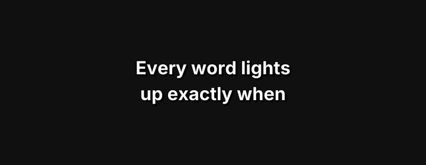
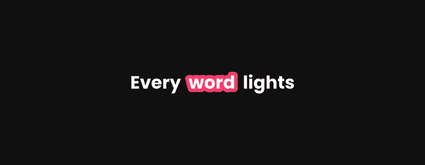
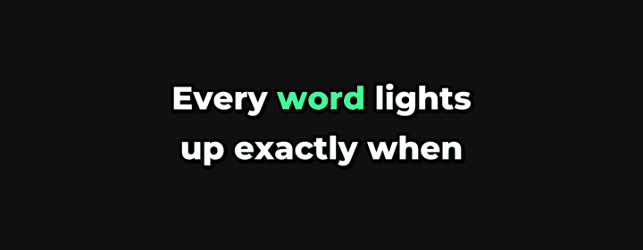
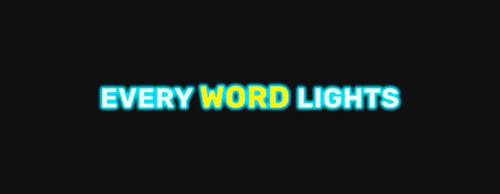
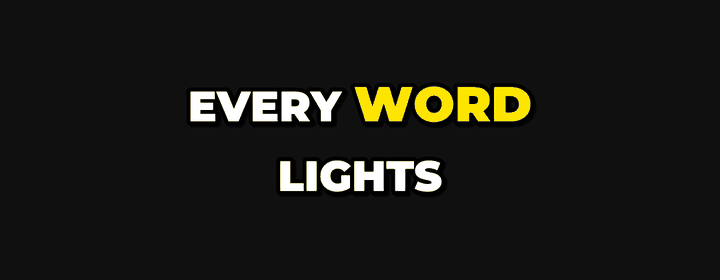
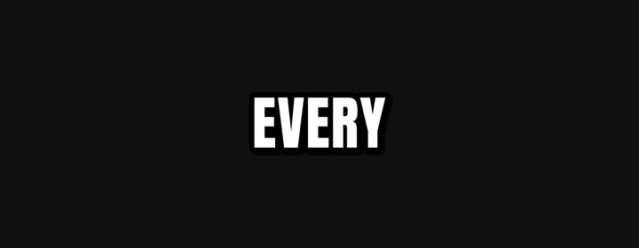
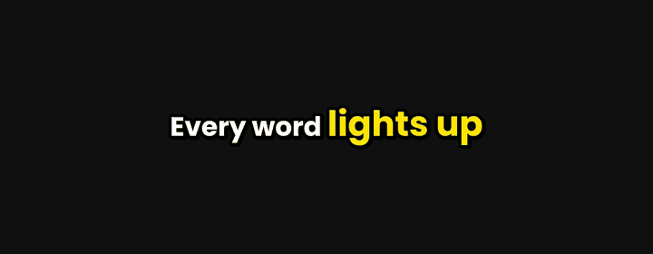
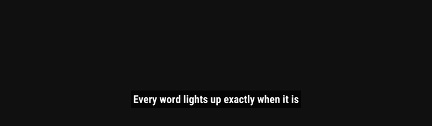
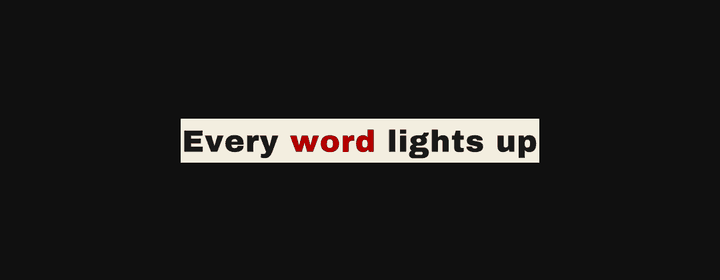
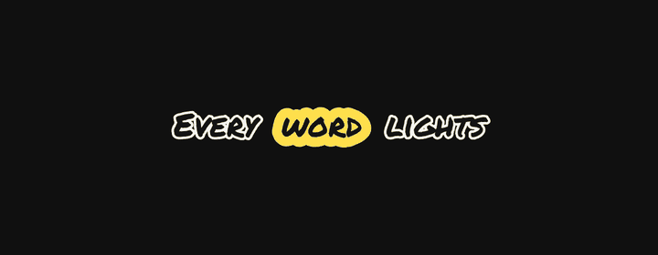

# Captions style guide

NarraReel ships ten caption presets. Each one is a JSON file in `narrareel/presets/styles/`, and every
value in it can be changed for a single run with `--set`. This page shows what each preset looks like, when it
works well, and which tweaks are worth trying.

List the presets any time with:

```bash
narrareel styles
```

## Try a style before you render

`narrareel preview` draws one caption frame, with no voice and no video render, so you can compare looks in a
second:

```bash
narrareel preview script.txt --style boxed -o boxed.png
narrareel preview script.txt --style boxed --set highlight.box_color=#00C2FF -o boxed-blue.png
```

`--set` takes `section.key=value` and can be repeated. Colours are hex (`#RRGGBB`). The same changes work with
`narrareel make`, and the web app's Captions step exposes the most useful ones as controls.

The frames below are `narrareel preview` output, cropped to the caption area. The script was
`Every word *lights up* exactly when it is spoken.`, so the highlighted word differs between styles.

## The presets

### `minimal`



Small white text near the bottom, no highlight. Use it for talking-head clips, tutorials and anything where the
captions should stay out of the way. If it feels too quiet, raise `--set font.size=80`, or move it up with
`--set layout.position=lower_middle`.

### `boxed`



White text with a pink box that jumps from word to word. A friendly default for lifestyle, explainer and
product videos. Change the box colour with `--set highlight.box_color=#00C2FF`, or make it softer with
`--set highlight.box_padding=6`.

### `karaoke`



Six words per caption, with the spoken word turning green. The longer lines suit calm narration, lyrics and
teaching content. Try `--set colors.highlight=#00E5FF` for cyan, or `--set layout.words_per_chunk=4` for
shorter lines.

### `neon`



Capital letters with a glow and a yellow active word. It looks best on dark or saturated footage, so use it for
gaming, tech and night-time clips. Swap the highlight with `--set colors.highlight=#FF4DFF`.

### `bold-pop`



Large black type with a thick outline and a yellow word that pops in. This is the default for Reels, TikTok and
Shorts because it stays readable on almost any background. Change the highlight with
`--set colors.highlight=#00E5FF`, or shorten the lines with `--set layout.words_per_chunk=2`.

### `one-word`



One huge word at a time, in the middle of the frame. It is fast and loud, so it works for hooks, motivational
clips and short punchy scripts. Shrink it for long words with `--set font.size=150`, or colour it with
`--set colors.text=#FFE600`.

### `keyword-emphasis`



White text where the words you mark with `*stars*` in the script grow and turn yellow. Use it when a few key
terms carry the message, such as numbers, names and claims. Recolour the emphasis with
`--set emphasis.color=#FF4D4D`.

### `subtitle-classic`



Plain, centred subtitles with up to eight words per line, drawn for widescreen (`--format youtube`). Use it for
long-form videos, courses and anything where the captions are an accessibility aid and not a graphic element.
Make it bigger for small screens with `--set font.size=70`.

### `typewriter`



Dark ink on a paper-coloured strip, with a red highlight that follows the voice. It has a quiet, editorial feel
that suits stories, book and quote videos and documentary-style narration. Change the highlight with
`--set colors.highlight=#0057FF`, or the paper with `--set colors.box=#FFFFFF`.

### `highlighter`



Marker-pen lettering with a yellow box that moves behind the active word. It is made for dark, calm footage,
where the yellow acts like a real highlighter pass, and suits study notes, reading lists and explainers. The
dark lettering has a light outline so it stays readable both on the video and inside the box. Change the pen
colour with `--set highlight.box_color=#7CFF6B`.

## Tweaks that work on any style

| Setting | What it does | Example |
|---|---|---|
| `colors.text` | Colour of the words that are not active | `--set colors.text=#FFE600` |
| `colors.highlight` | Colour of the active word (styles with a coloured word, not a box) | `--set colors.highlight=#00E5FF` |
| `highlight.box_color` | Colour of the moving box (`boxed`, `highlighter`) | `--set highlight.box_color=#00C2FF` |
| `font.size` | Type size in pixels at the format's full resolution | `--set font.size=90` |
| `font.uppercase` | Capitals on or off | `--set font.uppercase=true` |
| `layout.words_per_chunk` | How many words appear at once | `--set layout.words_per_chunk=2` |
| `layout.position` | `top`, `middle`, `lower_middle` or `bottom` | `--set layout.position=middle` |

Use `--font` to swap the typeface without touching the rest of the look, for example
`--font caveat-brush-regular`. List the bundled fonts with `narrareel fonts`.

Two things to keep in mind:

- **Safe zones.** Reels, TikTok and Shorts cover the bottom of the frame with buttons and the description. The
  `lower_middle` and `middle` positions stay clear of them; `bottom` sits closer to the edge, so check the
  preview before you use it with `--format reels`.
- **Colour contrast.** If you change colours, look at the preview on a frame that resembles your footage. Light
  text on a light background is the most common problem.

If you make a look you like, you can save it as your own preset from the web app, or copy one of the JSON files
in `narrareel/presets/styles/` and open a pull request.
